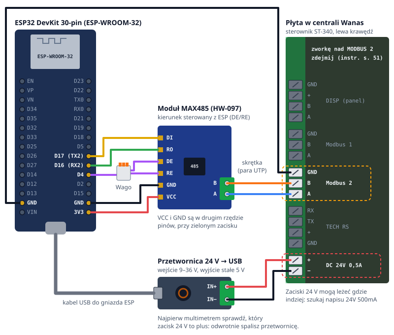

# Wanas → Home Assistant (ESPHome + Modbus RTU)

Lokalna integracja rekuperatora **Wanas** ze sterownikiem **ST-340 V2** (panel dotykowy „Display V2”) z Home Assistant. Bez chmury i bez modułu internetowego Wanas: ESP32 rozmawia ze sterownikiem po RS485 (Modbus RTU) i wystawia encje do HA przez ESPHome.

Dlaczego tak: sterownik ma dwa wbudowane porty Modbus RTU typu slave. Moduł Wanas Mobile Control (W-15 / W-19) działa tylko przez chmurę emodul.eu, a integracje HA dla eModul przy sterownikach wentylacji dają raczej tylko odczyt.

> **Status:** konfiguracja kompiluje się w CI, ale **jeszcze nie odczytała danych z prawdziwej centrali**. Pierwsza próba z modułem MAX3485 z automatycznym kierunkiem (bez pinu DE/RE) na „Modbus 2” dała same śmieci co 20 ms i brak odpowiedzi. Następna próba: moduł MAX485 z kierunkiem sterowanym z ESP, jak niżej. Patrz [Do sprawdzenia przy pierwszym uruchomieniu](#do-sprawdzenia-przy-pierwszym-uruchomieniu).

## Schemat podłączenia

| ESP32 DevKit | Moduł MAX485 (HW-097) | | Płyta Wanas „Modbus 2” |
|---|---|---|---|
| D17 / TX2 | DI | | |
| D16 / RX2 | RO | | |
| D4 | DE **i** RE (połączone razem) | | |
| 3V3 | VCC | | |
| GND | GND | | |
| drugi GND | | ↔ | GND |
| | A (zielony zacisk) | ↔ | A |
| | B (zielony zacisk) | ↔ | B |

- **Port „Modbus 2”, nie „Modbus 1”.** Instrukcja z 2025 r. (s. 44): „Do sterowania zaleca się wykorzystać złącze MODBUS 2”. Użytkownik Wanasa 250H na [forum ArturHome](https://forum.arturhome.pl/t/wanas-combo-430-integracja-z-rekuperatorem-po-modbus-rtu-rs485/16336) miał na „Modbus 1” cały czas „niedostępny”, a na „Modbus 2” od razu wartości.
- **Zdejmij zworkę nad „Modbus 2” / „TECH RS”.** Instrukcja (s. 51): „W razie braku komunikacji przez protokół Modbus RTU należy usunąć zworkę”. Po zdjęciu zrestartuj centralę (30 s bez prądu), bo sterownik może ją sprawdzać tylko przy starcie.
- **DE i RE razem do D4.** Na module leżą obok siebie. Bez płytki stykowej połącz trzy kabelki (z D4, DE i RE) jedną złączką Wago 221‑413, zrób mostek cyną między pinami albo wkręć dwa bolce w jeden zacisk adaptera śrubowego do ESP32.
- **GND sterownika osobnym kabelkiem z drugiego pinu GND na ESP.** Zacisk modułu ma tylko A i B. Bez wspólnej masy linie łapią przydźwięk 50 Hz.
- **VCC z 3V3.** MAX485 jest na 5 V i przy 3,3 V pracuje poza specyfikacją, ale zwykle działa i nie wymaga dzielnika. Jeśli nie zadziała: VCC na VIN (5 V z USB) i dzielnik na RO, 10 kΩ szeregowo do D16 i 20 kΩ z D16 do GND, bo pin ESP32 przyjmuje najwyżej 3,3 V.
- Kieruj się napisami na płytkach, nie kolejnością na rysunku.
- Rekuperator przed odkręcaniem zacisków **odłącz od prądu (230 V)**. „DISP” to panel dotykowy na własnej magistrali, więc ESP jest jedynym masterem na „Modbus 2”.
- Do rekuperatora poprowadź skrętkę, np. wolną parę z kabla UTP: A i B w jednej parze, GND osobno.
- Moduł internetowy Wanas (W‑15 / W‑19, eModul) [podobno wyklucza Modbus](https://github.com/mariusz-ostoja-swierczynski/tech-controllers/discussions/46): „You can use either modbus or wifi – not both”. Czy jest podłączony, sprawdzisz w menu serwisowym, w pozycji „Rejestracja modułu internetowego”: bez modułu wyskakuje błąd.

## Części

| Część | Uwagi |
|---|---|
| ESP32 DevKit z ESP-WROOM-32, 30 pinów (np. wersja z CH340 i USB-C) | `board: esp32dev`. Nie WROVER, bo tam GPIO16/17 zajmuje PSRAM |
| Moduł RS485 z pinami **DE i RE**: MAX485 „HW-097” (ok. 5 zł) albo Waveshare RS485 Board 3.3V (pin RSE = DE/RE) | Moduły z automatycznym kierunkiem (tylko VCC, RXD, TXD, GND) nadają same zera, a jedynki zostawiają rezystorom. U nas nie dostały odpowiedzi, choć jednemu użytkownikowi ArturHome taki zadziałał. Z nimi usuń `flow_control_pin` |
| Kabelki dupont żeńsko-męskie, złączka Wago 221-413, skrętka do centrali | Męski bolec wchodzi w zacisk śrubowy, żeński na piny modułu |
| Adapter śrubowy „ESP32 30pin Terminal Shield” (opcjonalnie) | Zamiast płytki stykowej, która potrafi mieć kilkanaście omów na styku |
| Zasilanie | Zasilacz USB 5 V do ESP **albo** przetwornica step-down 9–36 V → USB 5 V (stałe wyjście, bez potencjometru) z wyjścia „DC 24V max 0,5A” na płycie Wanas. Nigdy 24 V prosto na ESP |
| Przejściówka USB–RS485 na CH340 (opcjonalnie, ok. 7 zł) | Do diagnozy: komputer pyta sterownik bezpośrednio, bez ESP |

## Wgranie

Hasła do Wi-Fi nie ma w firmware. Ustawiasz je po wgraniu: przez USB w ESPHome Web albo przez hotspot „wanas-rekuperator”, który ESP otwiera, gdy nie może się połączyć z siecią.

1. `cp secrets.yaml.example secrets.yaml` i wpisz klucz z `openssl rand -base64 32`. Klucz szyfruje API i OTA, a Home Assistant zapyta o niego przy dodawaniu urządzenia.
2. Zbuduj plik do wgrania: `docker run --rm -v "$PWD":/config esphome/esphome:stable compile wanas-rekuperator.yaml`. Wynik to `.esphome/build/wanas-rekuperator/build/firmware.factory.bin`.
3. Wgraj przez przeglądarkę:
   1. Otwórz [web.esphome.io](https://web.esphome.io) w Chrome albo Edge (Safari i Firefox nie mają WebSerial).
   2. Podłącz ESP32 kablem USB z transmisją danych. Kabel tylko do ładowania nie wystarczy.
   3. Kliknij **Connect** i wybierz port CH340 (na Macu `cu.usbserial-…` / `cu.wchusbserial-…`, na Windowsie `COM…`). Jeśli portu nie ma, doinstaluj sterownik CH340 od WCH.
   4. Kliknij **Install**, wskaż `firmware.factory.bin` i poczekaj ok. minuty. Jeśli nie startuje, przytrzymaj na płytce **BOOT** w chwili, gdy zaczyna się wgrywanie.
   5. Po wgraniu ESPHome Web zaproponuje ustawienie Wi-Fi. Wybierz sieć i wpisz hasło.
4. Home Assistant wykryje urządzenie w *Ustawienia → Urządzenia i usługi → ESPHome*. Podaj klucz z `secrets.yaml`.
5. Kolejne aktualizacje idą przez Wi-Fi (OTA), np. `docker run --rm -v "$PWD":/config esphome/esphome:stable run wanas-rekuperator.yaml --device wanas-rekuperator.local`.

Zamiast przeglądarki można wgrać z linii poleceń przez USB: `esphome run wanas-rekuperator.yaml`.

## Co pojawi się w Home Assistant

**Odczyt:** wydatek nawiewu i wywiewu (m³/h, 0 przy braku funkcji XF), bieg nawiewu i wywiewu, temperatury (zewnętrzna, wyrzutu, nawiewu, pomieszczenia), dni do wymiany filtra, kod błędów, stan bypassu i GWC, „Filtr do wymiany”, siła sygnału Wi-Fi (przydaje się przy wyborze miejsca montażu).

**Sterowanie:** biegi stref 1–5 programu tygodniowego, funkcja impreza (0–720 min), kominek, ręczny bypass, urlop (0–30 dni).

ST-340 **nie ma rejestru „ustaw bieg teraz”**. Dlatego:
- bieg na stałe ustawiasz tym samym biegiem we wszystkich 5 strefach;
- do chwilowego wietrzenia służy funkcja impreza, np. automatyzacja „wilgotność w łazience > 70% → impreza 30 min”.

## Mapa rejestrów

Źródło: instrukcja Wanas 350/550/355/555 (V_041021), rozdz. 8 „MODBUS RTU”. Transmisja: **19200 b/s, 8E1, adres 1**, funkcje 0x03 / 0x06 / 0x10, wszystko to holding registers.

Adres w konfiguracji = **numer z instrukcji − 4001**. Poradnik Grentona czyta „4003 Bieg nawiewu” spod adresu 2.

| Adres | Nr w instrukcji | Nazwa | R/W | Wartości |
|---|---|---|---|---|
| 0 | 4001 | Wydatek nawiewu | R | m³/h, 0 = brak funkcji XF |
| 1 | 4002 | Wydatek wywiewu | R | m³/h |
| 2 | 4003 | Bieg nawiewu | R | 0 postój, 1 pusty dom, 2 praca, 3 wietrzenie |
| 3 | 4004 | Bieg wywiewu | R | jw. |
| 4–7 | 4005–4008 | Temp. zewnętrzna, wyrzutowa, nawiewowa, pomieszczenia | R | 0,1 °C ze znakiem, 63066 = błąd czujnika |
| 8 | 4009 | Dzień tygodnia | R/W | 0 niedziela … 6 sobota |
| 10–13 | 4011–4014 | Koniec strefy 1–4 | R/W | minuty od północy, krok 15 |
| 14–18 | 4015–4019 | Bieg strefy 1–5 | R/W | 0–3 |
| 19–23 | 4020–4024 | Temp. strefy 1–5 | R/W | 10–30 °C |
| 24 | 4025 | Adres Modbus | R/W | 1–254 |
| 25 | 4026 | Baud rate | R/W | 0:2400 1:4800 2:9600 3:19200 4:38400 5:57600 6:115200 |
| 26 | 4027 | Parametry transmisji | R/W | 0:N-8-1 1:E-8-1 2:O-8-1 3:N-8-2 4:E-8-2 5:O-8-2 |
| 29 | 4030 | EXTRA TEMP | R | jak temperatury |
| 30–35 | 4031–4036 | Stan: GWC, bypass, nawilżacz, nagrzewnica, chłodnica, urlop | R | 1 aktywne |
| 36 | 4037 | Wymiana filtra | R | 0 = wymień, 1–252 = dni do wymiany |
| 37 | 4038 | Błędy | R | bitowo |
| 38–43 | 4039–4044 | Aktywacja: GWC, bypass, nawilżacz (0/1), nagrzewnica (≤60 dni), chłodnica (≤60 dni), urlop (≤30 dni) | R/W | |
| 44 | 4045 | Funkcja kominek | R/W | instrukcja: „maks. 180 sekund” |
| 45 | 4046 | Funkcja impreza | R/W | minuty, maks. 720 |
| 46–49 | 4047–4050 | Wejścia: bieg 1, bieg 3, okap, ppoż. | R | |
| 50, 51 | 4051, 4052 | Data, godzina | R/W | |

**Kolejność bajtów:** sterownik wysyła młodszy bajt pierwszy. U Grentona surowa wartość 512 to bieg 2, a 61696 to 24,1 °C. Zamianę robią helpery w [`wanas_modbus.h`](wanas_modbus.h) (`wanas_word`, `wanas_encode`, `wanas_temperature`), przy odczycie i przy zapisie.

## Do sprawdzenia przy pierwszym uruchomieniu

| Objaw w logach ESPHome | Co zrobić |
|---|---|
| Same timeouty, brak odpowiedzi | Sprawdź w menu sterownika: Modbus włączony, 19200, E-8-1, adres 1. Zdejmij zworkę nad „Modbus 2” i zrestartuj centralę. Zamień A ↔ B, pomyłka niczego nie uszkodzi |
| „Frame already active”, „Poll refused by hub”, śmieci co 20 ms | Przydźwięk 50 Hz na linii. Sprawdź multimetrem ciągłość GND między ESP a GND „Modbus 2”. Jeśli na module jest rezystor 120 Ω („121”) przy zacisku A/B, a kabel jest krótki, wyłam go: zwiera polaryzację linii (napięcie A–B spada do ok. 0,04 V) |
| Nadal nic | Przejściówką USB–RS485 wyślij zapytanie z komputera prosto do sterownika. Odpowiedź oznacza, że winny jest moduł albo ESP. Brak odpowiedzi oznacza, że problem leży po stronie sterownika albo kabla |
| Wartości 256 razy za duże (bieg 512, temperatura 6000+) | W `wanas_modbus.h` ustaw `WANAS_SWAP_BYTES 0` |
| Wartości przesunięte o jeden rejestr (np. temperatura nawiewu tam, gdzie wyrzutu) | Adresacja jest od 1, nie od 0: dodaj 1 do każdego `address:` |
| Exception 0x02 (illegal address) | jw. albo inna wersja oprogramowania sterownika |

Instrukcja jest z 2021 r. Sterownik, na którym to powstało, ma wersję wyświetlacza 2.1.27 GR i modułu 2.1.27 G. Inna wersja może mieć przesuniętą mapę rejestrów.

## Pliki

- [`wanas-rekuperator.yaml`](wanas-rekuperator.yaml): konfiguracja ESPHome
- [`wanas_modbus.h`](wanas_modbus.h): zamiana bajtów, temperatury, kod błędu czujnika
- [`secrets.yaml.example`](secrets.yaml.example): wzór sekretów
- [`docs/wiring.svg`](docs/wiring.svg): schemat, generowany przez `node docs/wiring-svg.mjs docs/wiring.svg`
- [`.github/workflows/compile.yml`](.github/workflows/compile.yml): CI kompiluje firmware na `esphome/esphome:stable`, żeby wyłapać zmiany API ESPHome

## Źródła

- [Instrukcja Wanas 350/550/355/555 (PDF): Modbus RTU, schemat płyty Display V2](https://knowledgebase.grenton.com/hubfs/Documentation_Wanas.pdf)
- Instrukcja instalacji i obsługi Wanas 350/355 z 2025 r.: s. 44, zalecany port „Modbus 2”; s. 51, zworka
- [Forum ArturHome: Wanas po Modbus RTU / RS485](https://forum.arturhome.pl/t/wanas-combo-430-integracja-z-rekuperatorem-po-modbus-rtu-rs485/16336): ESP z MAX485 na „Modbus 2”
- [jrx-code/hassio-integration-wanas](https://github.com/jrx-code/hassio-integration-wanas): ta sama mapa rejestrów przez bramkę RS485 → TCP
- [Grenton: integracja z rekuperatorem Wanas](https://knowledgebase.grenton.com/integration-with-wanas-recuperator) (adresy rejestrów i kolejność bajtów ze zrzutów ekranu)
- [ESPHome Modbus Controller](https://esphome.io/components/modbus_controller/)
